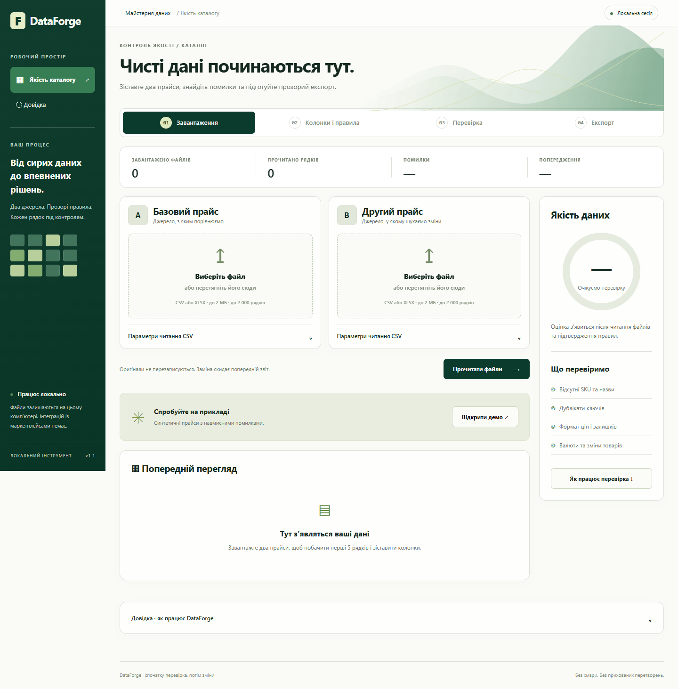
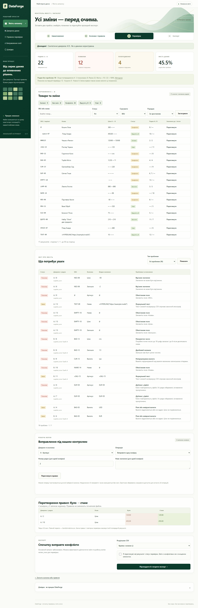
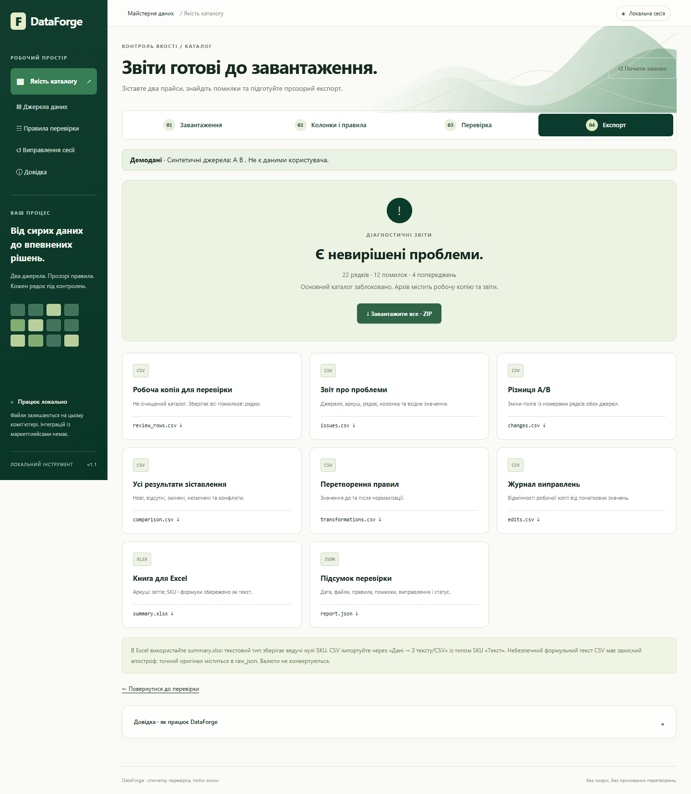

# DataForge — контроль качества товарных прайсов

**Формат:** самостоятельный учебный проект для портфолио. Не коммерческий заказ. Проверен локально 05.11.2026; публично не опубликован.

## Проблема и аудитория

Небольшие интернет-магазины получают несовместимые прайсы: разные колонки, пробелы в SKU, смешанные валюты, дубли, пропуски и числа в разных форматах. Если сразу импортировать такой файл, ошибки становятся частью каталога.

DataForge рассчитан на владельца магазина или контент-менеджера, которому нужно увидеть проблемы заранее и самостоятельно подтвердить изменения.

## Решение

Оригинальный интерфейс на украинском ведет через четыре этапа: загрузка двух источников, сопоставление колонок и правил, проверка, подтвержденный экспорт. Спокойная зеленая палитра отделяет рабочие действия от красных ошибок и желтых предупреждений. На узких экранах формы переходят в одну колонку, а большие таблицы прокручиваются внутри карточек.

Приложение читает CSV и XLSX, показывает исходные записи, сохраняет SKU как текст и меняет его только по выбранным пользователем правилам. Дубли и коллизии не объединяются автоматически. Разные валюты не сравниваются как одинаковые; разные названия останавливают сопоставление идентичности. Пользователь видит журнал «до/после» перед созданием файлов.

Экспорт содержит все записи со статусами, происхождением и снимком первоначальных полей, отдельные отчеты и книгу Excel. Защита от формул применяется к CSV и XLSX. Исходные файлы остаются нетронутыми.

## Стек и ограничения

Python, FastAPI, Jinja2, стандартный csv, Decimal, openpyxl и defusedxml; pytest, Ruff и Playwright для проверки. Нет внешних API, облачного хранилища или интеграций с торговыми площадками. Лимиты — 2 МБ и 2000 записей на файл; XLSX с одним листом. Сессия в памяти, срок — один час бездействия. Валюты не конвертируются.

## Реальная проверка

50 автоматических тестов прошли. Lint, компиляция Python и проверка зависимостей успешны. В Microsoft Edge пройден полный путь на ширинах 360, 768 и 1440 px, включая фильтрацию, подтверждение, реальное скачивание ZIP и восстановление после ошибки кодировки. Все 22 строки демонстрационных данных сохранились. Найденные во время проверки проблемы исправлены и перепроверены.

Показатели демо без очистки со сравнением: 12 ошибок, 10 предупреждений, 2 преобразования, 16 событий сравнения. Это характеристики вымышленного набора, а не бизнес-метрики. Полный отчет и непройденные вручную проверки: [QA.md](QA.md).

## Три скриншота реального интерфейса

### Загрузка двух источников

### Проверка до применения

### Готовый экспорт

Дополнительно: [мобильная версия 360 px](artifacts/step-1-360.png), [экспорт на планшете 768 px](artifacts/step-4-768.png).

## Готовый текст для карточки портфолио

**Название:** DataForge — мастерская товарных данных.

**Описание:** Локальный инструмент для проверки и сравнения двух товарных прайсов CSV/XLSX. Показывает ошибки до применения правил, сохраняет каждую строку и создает безопасный экспорт с отчетами. Украинский интерфейс, адаптивная верстка и проверенные сценарии обработки данных.

**Технологии:** Python · FastAPI · Jinja2 · openpyxl · pytest · Playwright.

**Тип проекта:** самостоятельный учебный кейс.

**Материалы для добавления на отдельный сайт:**

- Полное описание: этот файл `portfolio-case.md`.
- Обложка: `artifacts/step-1-1440.png`.
- Галерея: `artifacts/step-3-1440.png`, `artifacts/step-4-1440.png`.
- Подробности проверки: `QA.md`.
- Демо: только локально `http://127.0.0.1:8765`, после `start.cmd`. Это не публичная ссылка.
- Публичный репозиторий / размещенное демо: отсутствуют; не публиковались.

Файлы отдельного сайта-портфолио и `profile.js` не изменялись. Решение о публикации и статусе карточки остается за владельцем.
